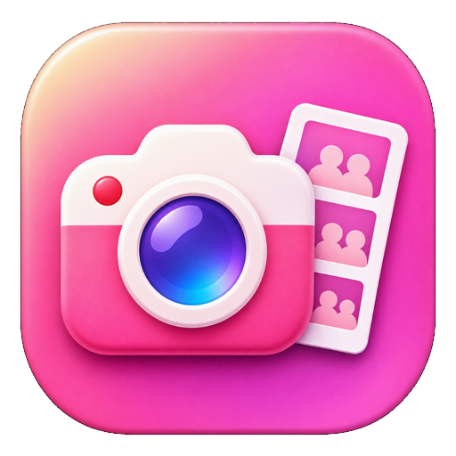
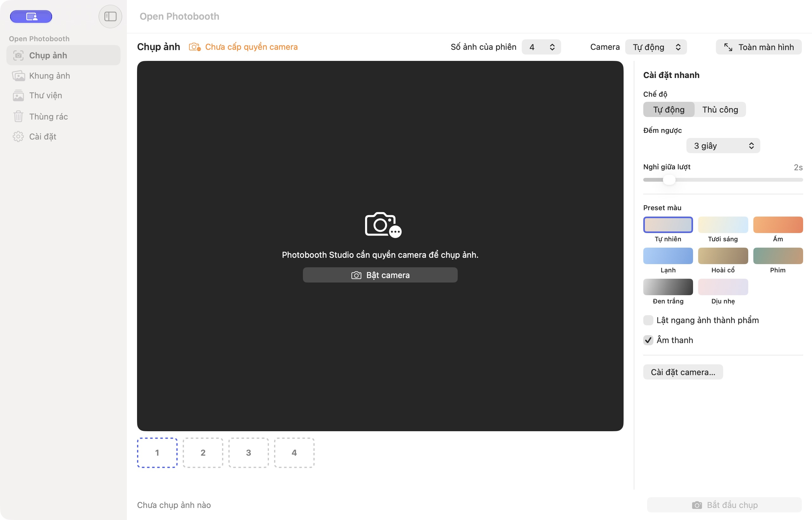

<p align="center">
  
</p>

# Open Photobooth

**Biến máy Mac thành photobooth cá nhân: chụp ảnh, chọn khung, chỉnh màu và xuất ảnh ngay trên máy.**

Open Photobooth là ứng dụng macOS viết bằng Swift và SwiftUI, có giao diện tiếng Việt. Phù hợp để chụp ảnh cá nhân hoặc bố trí một góc photobooth tại sự kiện. Không cần tài khoản hay máy chủ riêng; ảnh và dữ liệu phiên chụp được lưu cục bộ.

**[Tải bản cài đặt mới nhất](https://github.com/teakay1311/OpenPhotobooth/releases/latest)** · [Hướng dẫn sử dụng](DOCS/HUONG_DAN_SU_DUNG.md) · [Apache 2.0](LICENSE)



*Ảnh chụp giao diện thật ở lần mở đầu, trước khi cấp quyền camera; vùng xem trước sẽ hiển thị camera sau khi bạn cho phép truy cập.*

## Tính năng hiện có

- **Chụp theo phiên:** chọn số ảnh, chụp tự động hoặc thủ công, đặt đếm ngược và khoảng nghỉ; hỗ trợ camera Mac, USB và Continuity Camera khi thiết bị khả dụng.
- **Chọn khung sau khi chụp:** dùng 9 bố cục có sẵn hoặc nhập PNG/JPG; quản lý danh mục, yêu thích và gói khung `.photoframepack`. Trình sửa khung cho phép bố trí ô ảnh, đổi kích thước, bo góc, thứ tự lớp và hoàn tác.
- **Xem lại và chỉnh sửa:** chọn ảnh vào khung, chụp lại, đổi khung, căn vị trí, phóng to/thu nhỏ, dùng Fill/Fit/Auto Face và điều chỉnh màu với 8 preset có sẵn.
- **Xuất và chia sẻ:** lưu JPG hoặc PNG, chọn kích thước và chất lượng JPG; tùy chọn tự động xuất và chia sẻ qua bảng chia sẻ của macOS.
- **Quản lý trên máy:** thư viện phiên chụp, Thùng rác với thời gian lưu 30 ngày, khôi phục mục đã xóa và chế độ photobooth toàn màn hình.

## Cài đặt trên macOS

Yêu cầu **macOS 14.0 trở lên**, máy Mac Intel hoặc Apple Silicon và camera tương thích. Bản DMG Universal dùng chung cho hai loại máy.

1. Mở [Releases](https://github.com/teakay1311/OpenPhotobooth/releases/latest), tải tệp `.dmg` trong mục **Assets**.
2. Mở DMG và kéo **Open Photobooth.app** vào thư mục **Applications**.
3. Mở ứng dụng từ Applications. Bản phát hành hiện tại ký **ad-hoc, chưa được Apple notarize**. Nếu macOS chặn vì không xác minh được nhà phát triển, chỉ khi đã xác nhận tệp tải từ repo này, mở **System Settings → Privacy & Security → Open Anyway (Vẫn mở)** và làm theo thông báo của macOS.
4. Trong màn **Chụp ảnh**, bấm **Bật camera** và cho phép truy cập camera. Nếu từng từ chối, mở **System Settings → Privacy & Security → Camera** để kiểm tra quyền của ứng dụng. Ứng dụng không yêu cầu microphone.

Mỗi Release có tệp `SHA256SUMS.txt`. Để đối chiếu bản tải về, đặt nó cùng thư mục với DMG và chạy:

```sh
shasum -a 256 -c SHA256SUMS.txt
```

## Chụp bộ ảnh đầu tiên

1. Ở **Chụp ảnh**, chọn camera và **Số ảnh của phiên**. Chỉnh chế độ **Tự động/Thủ công**, đếm ngược, khoảng nghỉ và preset màu ở cột **Cài đặt nhanh**.
2. Bấm **Bắt đầu chụp** hoặc `Space`. Với chế độ thủ công, chủ động chụp từng lượt; `Esc` hủy lượt đếm ngược đang chạy.
3. Sau khi chụp đủ ảnh, bấm **Chọn khung**, chọn mẫu và sắp ảnh theo thứ tự mong muốn. Bấm **Dùng khung này** để tiếp tục.
4. Trong **Xem và chỉnh ảnh**, căn vị trí, crop, chỉnh màu hoặc chụp lại nếu cần. Bấm **Xuất ảnh** để lưu JPG/PNG, hoặc **Chia sẻ**. **Hoàn thành** kết thúc phiên; tự động xuất chỉ chạy khi đã bật và chọn thư mục xuất.
5. Mở **Thư viện** để xem lại phiên đã lưu. Mục đã xóa có thể khôi phục trong **Thùng rác** trước khi bị dọn vĩnh viễn.

Chi tiết về chỉnh khung, xuất ảnh, kiosk và phím tắt: [Hướng dẫn sử dụng](DOCS/HUONG_DAN_SU_DUNG.md).

## Bộ khung photobooth do tác giả thiết kế

**[Xem và tải bộ khung photobooth trên Google Drive](https://drive.google.com/drive/folders/13KEwOqD2UtkGpgbjSFe3B33uLIErZSoG?usp=sharing)**

Đây là thư mục tổng hợp các khung photobooth do tác giả tự thiết kế, giúp bạn chọn mẫu để dùng cùng Open Photobooth. Sau khi tải khung về, mở **Khung ảnh → Thêm khung** để nhập PNG/JPG, hoặc **Nhập Frame Pack** nếu tệp có đuôi `.photoframepack`. Kiểm tra các ô đặt ảnh trong trình sửa khung trước khi sử dụng. Đây là tài nguyên tải riêng; ứng dụng không tự đồng bộ nội dung Google Drive.

## Build từ mã nguồn

Cần macOS 14+, Xcode có macOS SDK và [XcodeGen](https://github.com/yonaskolb/XcodeGen). Với Homebrew, có thể cài XcodeGen bằng `brew install xcodegen`.

```sh
git clone https://github.com/teakay1311/OpenPhotobooth.git
cd OpenPhotobooth
bash Scripts/make_app.sh
```

Ứng dụng Universal được tạo tại `Build/Release/Open Photobooth.app`. Script dùng chữ ký ad-hoc; không thực hiện notarization. Mã nguồn không có dependency Swift bên ngoài, sử dụng framework của macOS và SQLite hệ thống.

Để chạy kiểm thử trong bản sao QA tách biệt:

```sh
bash Scripts/qa_test.sh
```

Script tạo thư mục tạm và dùng bundle ID QA riêng. `swift build -c release` có thể dùng để kiểm tra biên dịch qua Swift Package Manager; để có app bundle đầy đủ tài nguyên và quyền camera, dùng script đóng gói ở trên.

## Giấy phép

Dự án được phát hành theo **[Apache License 2.0](LICENSE)**. Thông tin ghi nhận tác giả nằm trong [NOTICE](NOTICE). Giấy phép của repo không tự quy định điều khoản cho các tài nguyên được lưu riêng ngoài repo, bao gồm nội dung tại liên kết Google Drive.
